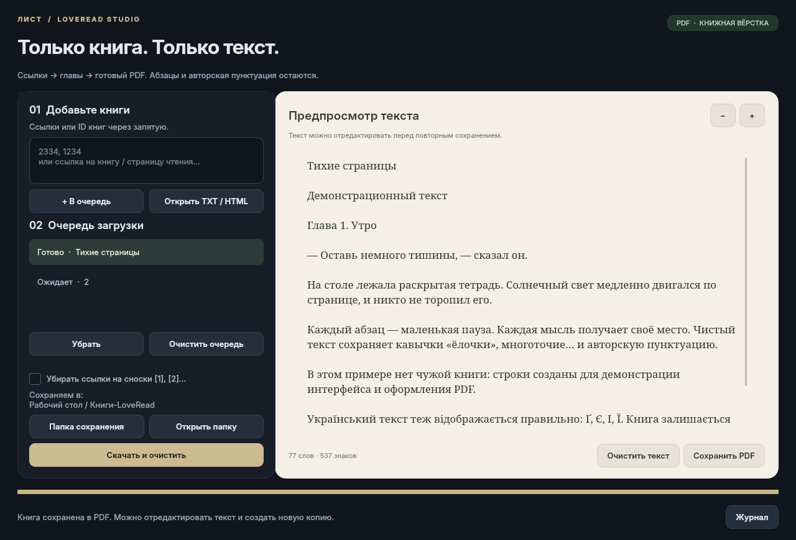
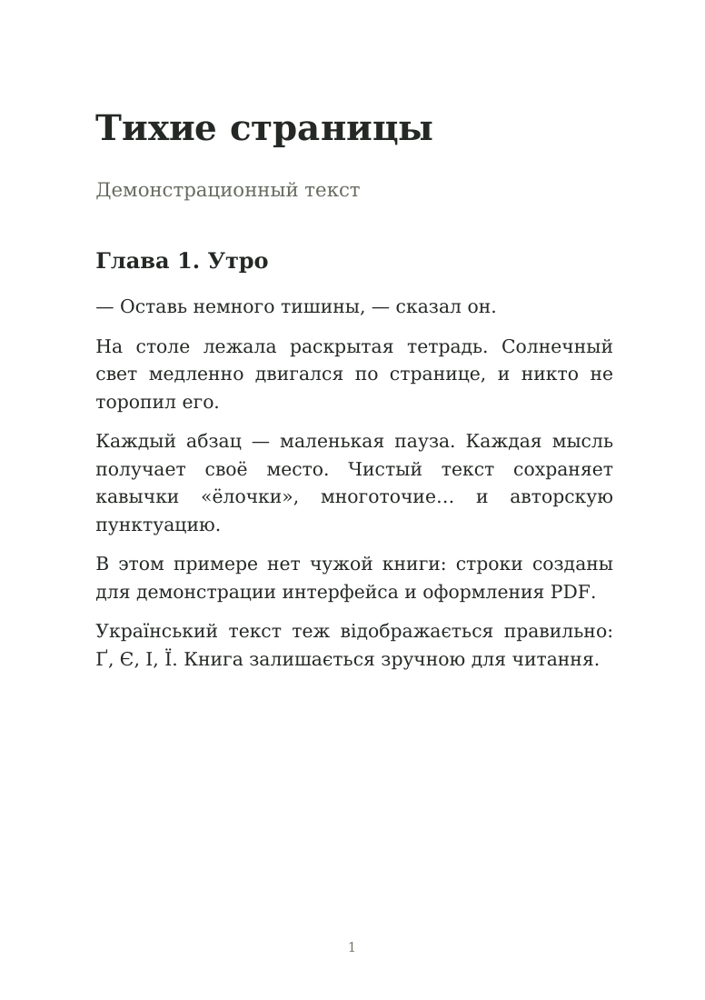

<div align="center">


# 📖 Лист · LoveRead Studio

### Книги с LoveRead → чистый текст → аккуратный PDF

**Графический интерфейс · очередь книг · кириллица · предпросмотр · редактирование**

[🚀 Установка](#-установка-на-linux) · [🖥 Интерфейс](#-как-выглядит-программа) · [📚 Использование](#-как-скачать-книгу) · [🛠 Решение проблем](#-если-что-то-не-работает) · [🐙 Загрузка на GitHub](#-как-загрузить-этот-проект-на-github)

</div>

---

## ✨ Что это за программа

**LoveRead Studio** — настольное приложение для загрузки доступного текста книг с `loveread.ec`, его очистки и автоматического сохранения в PDF.

Добавьте одну ссылку или несколько ID, нажмите **«Скачать и очистить»** — программа последовательно получит страницы, соберёт текст и создаст отдельный PDF для каждой книги. Готовый текст можно просмотреть, отредактировать и сохранить ещё одной копией.

| Возможность | Что получает пользователь |
| :--- | :--- |
| 📚 Очередь | Несколько книг за один запуск; ID через запятую или ссылки |
| 🧹 Чистый текст | Удаление HTML-разметки, известных рекламных блоков и скрытых символов |
| 💬 Сохранение смысла | Абзацы, диалоги, тире, кавычки и авторская пунктуация остаются |
| 📄 Автоматический PDF | Формат A5, встроенные шрифты, заголовки и номера страниц |
| 🔎 Предпросмотр | Чтение, редактирование, масштаб текста и счётчик слов |
| 🗂 Локальные файлы | Открытие TXT / HTML, в том числе перетаскиванием в окно |
| ⏳ Фоновая загрузка | Прогресс и журнал; интерфейс остаётся доступным |
| 🛑 Отмена | Кнопка остановки; завершённые книги остаются на диске |
| 🟡 Контроль полноты | Неполный результат явно отмечается в очереди и имени PDF |
| 💾 Сохранность файлов | Повторная запись создаёт `(2)`, `(3)` — старые файлы остаются |

Приложение использует исходный [loveread_book_multiparser](https://github.com/premiumpodpiska3454-debug/loveread_book_multiparser). Его файлы уже включены в `upstream/`: отдельно скачивать исходный парсер не нужно.

## 🖥 Как выглядит программа



*Настоящий интерфейс с собственным демонстрационным текстом. Слева — очередь и настройки, справа — редактор. Это иллюстрация интерфейса, а не результат загрузки чужой книги.*

<details>
<summary><strong>📄 Посмотреть пример книжной вёрстки PDF</strong></summary>



PDF содержит текст, который можно выделять, копировать и находить поиском. Кириллические шрифты включены в проект и встраиваются в документ.

</details>

## 📦 Что нужно скачать и установить

| Компонент | Для чего нужен | Как получить |
| :--- | :--- | :--- |
| **Файлы этого проекта** | Само приложение, парсер, шрифты и скрипты | **Code → Download ZIP** в репозитории или Git |
| **Python 3.10+** | Запуск программы | На Debian / Ubuntu / Parrot — пакет `python3`; на Windows / macOS — [python.org](https://www.python.org/downloads/) |
| **venv и pip** | Отдельное окружение и установка библиотек | На Debian / Ubuntu / Parrot — `python3-venv` и `python3-pip` |
| **Git** | Скачивание и обновление через Git | Необязателен, если вы скачали ZIP |
| **Интернет** | Первая установка библиотек и загрузка страниц LoveRead | Для очистки локального текста после установки сеть не нужна |

**Python-библиотеки устанавливаются автоматически из `requirements.txt`:**

| Библиотека | Назначение |
| :--- | :--- |
| `PySide6` | Окно программы, кнопки, очередь и редактор |
| `requests` | Получение страниц сайта |
| `beautifulsoup4` | Разбор HTML и извлечение текста |
| `reportlab` | Создание PDF с кириллицей и книжной вёрсткой |

Отдельно устанавливать Qt Creator или скачивать шрифты не требуется. Пакеты PySide6 включают библиотеки Qt — это описано в [официальной инструкции Qt for Python](https://doc.qt.io/qtforpython-6/gettingstarted.html).

> **Проверенная конфигурация:** Linux / Parrot, Python **3.13.5**, PySide6 **6.8.2.1**, Requests **2.32.3**, Beautiful Soup **4.13.4**, ReportLab **5.0.1**. Другие версии в пределах `requirements.txt` отдельно не проверялись. Windows и macOS имеют инструкции ниже, но на них сборка пока не тестировалась.

## 🚀 Установка на Linux

Основной путь — Debian / Ubuntu / Parrot с обычным графическим рабочим столом.

### 1. Установите системные компоненты

Откройте терминал и выполните:

```bash
sudo apt update
sudo apt install python3 python3-venv python3-pip git
```

Проверьте Python:

```bash
python3 --version
```

Для воспроизведения проверенной конфигурации используйте Python 3.13. Если Python уже установлен, переустанавливать его не нужно.

### 2. Скачайте проект

**Вариант A — через браузер, без Git:**

1. Откройте репозиторий приложения на GitHub.
2. Нажмите зелёную кнопку **Code**.
3. Выберите **Download ZIP**.
4. Распакуйте архив в удобное место, например на рабочий стол.
5. Откройте полученную папку: в ней должны находиться `README.md`, `run.py`, `install.sh`, `start.sh` и папки `gui/`, `upstream/`.
6. Нажмите правой кнопкой мыши по пустому месту → **«Открыть терминал здесь»**.

**Вариант B — через Git:**

Замените `YOUR_USERNAME/YOUR_REPOSITORY` на адрес вашего репозитория **с графической версией**:

```bash
git clone https://github.com/YOUR_USERNAME/YOUR_REPOSITORY.git LoveRead-Studio
cd LoveRead-Studio
```

`YOUR_USERNAME` и `YOUR_REPOSITORY` — заполнители. Адрес исходного консольного парсера находится в разделе благодарностей; его файлы уже есть в этой сборке.

### 3. Установите зависимости

Из папки проекта:

```bash
bash install.sh
```

Скрипт создаст `.venv` в папке приложения и установит нужные Python-библиотеки в это окружение. Интернет необходим. Первая установка PySide6 может занять заметное время: дождитесь сообщения **«Установка завершена»**.

### 4. Запустите приложение

```bash
bash start.sh
```

Альтернативное имя того же запуска:

```bash
bash Запустить.sh
```

Если зависимости ещё не установлены, `start.sh` вызовет установку. Если готовое окружение `.venv` уже есть, оно используется в первую очередь.

### 5. Создайте ярлык на рабочем столе

После установки выполните:

```bash
.venv/bin/python create_shortcut.py
```

Появится **LoveRead Studio** на рабочем столе и в меню приложений. Ярлык указывает на текущую папку программы. Если рабочий стол спросит, разрешить ли запуск файла, выберите разрешение запуска.

Если папка была перемещена, снова выполните генератор ярлыка из нового расположения.

<details>
<summary><strong>🔧 Ручная установка без install.sh</strong></summary>

Выполните из папки проекта:

```bash
python3 -m venv .venv
.venv/bin/python -m pip install --upgrade pip
.venv/bin/python -m pip install -r requirements.txt
.venv/bin/python run.py
```

Активация окружения не обязательна: здесь прямо указан его Python. Подробнее — в [документации Python о venv](https://docs.python.org/3/library/venv.html).

</details>

## 🪟 Windows и 🍎 macOS

Эти инструкции приведены для ручного запуска; на данных ОС проект ещё не проверялся. Генератор `.desktop`-ярлыков предназначен для Linux.

### Windows — PowerShell

1. Установите [Python с официального сайта](https://www.python.org/downloads/).
2. Скачайте ZIP проекта и распакуйте его.
3. Откройте PowerShell в папке приложения.
4. Выполните:

```powershell
py -3 -m venv .venv
.\.venv\Scripts\python.exe -m pip install --upgrade pip
.\.venv\Scripts\python.exe -m pip install -r requirements.txt
.\.venv\Scripts\python.exe run.py
```

Если команда `py` недоступна, проверьте установку Python; можно заменить первую команду на `python -m venv .venv`. Менять политику выполнения PowerShell для этих команд не требуется: активация окружения не используется.

### macOS — Terminal

После установки Python и распаковки проекта откройте его папку в Terminal:

```bash
python3 -m venv .venv
.venv/bin/python -m pip install --upgrade pip
.venv/bin/python -m pip install -r requirements.txt
.venv/bin/python run.py
```

## 📚 Как скачать книгу

### Шаг 1. Добавьте книгу

В левое поле можно вставить:

**Один ID:**

```text
2334
```

**Несколько ID:**

```text
2334, 1234, 5678
```

**Ссылку на карточку:**

```text
https://loveread.ec/view_global.php?id=2334
```

**Ссылку на страницу чтения:**

```text
https://loveread.ec/read_book.php?id=2334&p=1
```

Это примеры формата ввода. Доступность соответствующих книг не проверена. Можно разделять элементы запятыми, пробелами или переносами строк. Поддерживается сайт `loveread.ec`, указанный в исходном парсере.

Ссылка на страницу с `p=8` всё равно запускает сбор с первой страницы книги. Повторные ссылки на один ID не создают дубликаты в очереди.

### Шаг 2. Выберите папку

По умолчанию PDF сохраняются в:

```text
~/Desktop/Книги-LoveRead
```

Кнопка **«Папка сохранения»** позволяет выбрать другое место. Выбор запоминается. На системах с перенесённым рабочим столом, например в OneDrive, выберите фактическую папку вручную.

### Шаг 3. Запустите загрузку

Нажмите **«В очередь»**, затем **«Скачать и очистить»**. Можно сразу нажать **«Скачать и очистить»** — введённые элементы будут добавлены автоматически.

Книги обрабатываются последовательно. Текущая страница отображается в строке состояния; технические события доступны через **«Журнал»**.

### Шаг 4. Получите PDF

После загрузки PDF сохраняется автоматически. Выберите книгу в очереди, чтобы увидеть её текст в правой части окна. **«Открыть папку»** покажет сохранённые файлы.

## 🧹 Очистка, редактирование и локальные файлы

Программа убирает HTML-разметку, известные рекламные элементы, невидимые символы, мягкие переносы, лишние пробелы и повторяющиеся пустые строки.

**Тире, кавычки, многоточия, диалоги и абзацы сохраняются.** Нормальные авторские знаки не вырезаются ради «чистоты».

- **«Убирать ссылки на сноски [1], [2]…»** — необязательная настройка. По умолчанию сноски остаются.
- **«Открыть TXT / HTML»** — загрузить собственный текст с диска.
- Можно перетащить TXT / HTML прямо в окно приложения.
- **«Очистить текст»** — применить очистку к текущему предпросмотру.
- Поле предпросмотра редактируется обычным способом, как текстовый редактор.
- **«−» / «+»** меняют размер текста в предпросмотре.
- **«Сохранить PDF»** создаёт PDF из отредактированного текста.

Импорт TXT поддерживает UTF-8, UTF-16 с BOM и Windows-1251. PDF не импортируется: это выходной формат программы.

## 📄 Как оформляется PDF

| Элемент | Оформление |
| :--- | :--- |
| Размер | A5, удобно для книжного текста |
| Основной текст | DejaVu Serif, 11 pt, межстрочный интервал 16,5 pt |
| Заголовки | Полужирный шрифт и увеличенные отступы |
| Кириллица | Шрифты включены в папку проекта и встраиваются в PDF |
| Страницы | Автоматические переносы и нумерация |
| Длинные абзацы | Переносятся на следующие страницы |
| Текст | Можно выделить, скопировать и искать |

Название и автор определяются из разметки сайта. Если название не найдено, используется `Книга ID`. Предпросмотр показывает текст, а не точную постраничную копию PDF; размер шрифта предпросмотра не меняет книжную вёрстку.

## 🟡 Ошибки, остановка и неполные книги

| Статус в очереди | Что означает |
| :--- | :--- |
| **Ожидает** | Книга добавлена в очередь |
| **Загружаем** | Получаются страницы |
| **Готово** | Текст собран, PDF сохранён |
| **Неполная** | Есть часть текста, но полная загрузка не подтверждена |
| **Ошибка** | Не удалось получить или сохранить книгу |
| **Остановлено** | Пользователь остановил текущую загрузку |

При обрыве загрузки уже полученный текст сохраняется в PDF с префиксом:

```text
[НЕПОЛНАЯ — 4 из 12] Название.pdf
```

Такая книга не помечается готовой. После исправления причины нажмите **«Скачать и очистить»** ещё раз: неготовые книги будут загружаться с начала. Докачка с конкретной страницы пока не реализована.

Кнопка **«Остановить загрузку»** прерывает ожидание сразу либо дожидается окончания текущего HTTP-запроса. Завершённые книги сохраняются. Текущая книга при ручной отмене не записывается как готовая.

Без пагинации конец текста определяется по повтору страницы или HTTP 404 следующей страницы. Отсутствие текста или другая ошибка не считается подтверждением полной загрузки. Сам сайт может изменить разметку или доступность страниц.

## 🛠 Если что-то не работает

<details>
<summary><strong>python3: command not found</strong></summary>

На Debian / Ubuntu / Parrot установите Python:

```bash
sudo apt install python3 python3-venv python3-pip
```

На Windows / macOS проверьте установку Python и откройте терминал заново.

</details>

<details>
<summary><strong>Ошибка venv, ensurepip или externally-managed-environment</strong></summary>

На Debian-подобной системе:

```bash
sudo apt install python3-venv python3-pip
bash install.sh
```

Устанавливайте библиотеки в окружение `.venv`, как в инструкции. Запускать `sudo pip install` не требуется.

</details>

<details>
<summary><strong>ModuleNotFoundError: PySide6 / requests / bs4 / reportlab</strong></summary>

Из папки проекта выполните:

```bash
bash install.sh
bash start.sh
```

Если ставили вручную, используйте тот же Python окружения, которым установлены зависимости:

```bash
.venv/bin/python run.py
```

</details>

<details>
<summary><strong>Окно сразу закрывается или ошибка платформенного плагина Qt</strong></summary>

Запустите приложение из терминала, чтобы увидеть сообщение:

```bash
bash start.sh
```

Если ошибка прямо указывает на недостающие библиотеки `xcb`, на Debian / Ubuntu / Parrot могут потребоваться:

```bash
sudo apt install libxcb-cursor0 libxkbcommon-x11-0 libxcb-xinerama0 libegl1
```

Программе нужен работающий графический сеанс. Сервер без рабочего стола не покажет окно приложения.

</details>

<details>
<summary><strong>HTTP 401 / 403 / 429 или ошибка сети</strong></summary>

Откройте **«Журнал»** и проверьте причину. Убедитесь, что книга открывается в обычном браузере и интернет работает. При временном ограничении сайта повторите попытку позже. Эти ответы не обходятся программой.

</details>

<details>
<summary><strong>Текст не найден в блоке textBook</strong></summary>

Проверьте ID и ссылку. Возможно, книга недоступна или сайт изменил HTML-разметку. Парсер не будет сохранять страницу ошибки как текст книги. Для диагностики приложите к сообщению об ошибке ссылку и строку из журнала.

</details>

<details>
<summary><strong>PDF не появляется или не открывается папка</strong></summary>

Проверьте выбранную папку, права на запись и свободное место. Через **«Папка сохранения»** выберите доступную папку пользователя. Все PDF сохраняются туда, где указано в левой части окна.

</details>

<details>
<summary><strong>Ярлык перестал работать после перемещения папки</strong></summary>

Из нового расположения выполните:

```bash
.venv/bin/python create_shortcut.py
```

Если вместе с программой переносили `.venv`, пересоздайте окружение по инструкции установки: виртуальные окружения [не предназначены для переноса между каталогами и компьютерами](https://docs.python.org/3/library/venv.html).

</details>

## 🧪 Проверки для разработчиков

В проект включены **30 автоматических проверок**. Они покрывают очистку текста, кодировки, пагинацию, неполные загрузки, отмену, очередь, редактирование, PDF, кириллицу и сохранность текста при переносах.

Для проверки содержимого PDF в Linux установите Poppler:

```bash
sudo apt install poppler-utils
```

После установки зависимостей выполните из папки проекта:

```bash
QT_QPA_PLATFORM=offscreen .venv/bin/python -m unittest discover -s tests -v
```

Тесты используют короткие собственные тексты и подставные HTTP-ответы: чужие книги при проверке не скачиваются. Локальные проверки прошли; интерфейс и PDF также визуально проверены. Реальная загрузка с LoveRead из среды подготовки не проверялась из-за ограничения её сетевого доступа.

## 🗂 Структура проекта

```text
LoveRead-Studio/
├── README.md                    # Эта инструкция
├── requirements.txt             # Python-зависимости
├── requirements-gui.txt         # Совместимое имя списка зависимостей
├── install.sh                   # Установка в .venv
├── start.sh                     # Запуск приложения
├── Запустить.sh                 # Русское имя скрипта запуска
├── create_shortcut.py           # Создание ярлыка для текущего расположения
├── run.py                       # Точка входа
├── .gitignore                   # Исключения для локальных файлов
├── .gitattributes               # Переносы строк и двоичные ресурсы
├── THIRD_PARTY_NOTICES.md        # Источники и сторонние компоненты
├── gui/
│   ├── app.py                   # Главное окно и очередь
│   ├── backend.py               # Адаптер исходного парсера
│   ├── text_tools.py            # Очистка и обработка текста
│   ├── pdf_export.py            # Книжная вёрстка PDF
│   ├── icon.svg                 # Иконка приложения
│   └── assets/fonts/            # Шрифты и их лицензия
├── upstream/
│   ├── multiparser.py           # Исходный консольный парсер
│   └── README.md                # Документация его автора
├── tests/                       # 30 проверок
└── docs/
    ├── banner.svg               # Баннер README
    ├── interface.png            # Интерфейс с демонстрационным текстом
    ├── pdf-preview.png          # Пример оформления PDF
    └── TECHNICAL.md             # Дополнительные заметки
```

`.venv`, скачанные книги и история локального Git не включены в эту папку. В `upstream/` лежат обычные файлы, поэтому после загрузки на GitHub дополнительная настройка подмодулей не нужна.

## 🐙 Как загрузить этот проект на GitHub

### Вариант 1. Через браузер

1. Войдите в GitHub и создайте новый репозиторий, например **LoveRead-Studio**.
2. Откройте страницу нового репозитория и выберите **uploading an existing file**; в существующем репозитории — **Add file → Upload files**.
3. Откройте эту папку на компьютере.
4. Выделите **её содержимое**, чтобы `README.md` оказался в корне репозитория, и перетащите файлы с папками в область загрузки.
5. В Linux нажмите **Ctrl+H**, если нужно показать и включить скрытые `.gitignore` и `.gitattributes`.
6. Укажите сообщение, например `Add LoveRead Studio GUI and PDF export`.
7. Подтвердите создание коммита.

После загрузки GitHub покажет этот README со скриншотами. Не загружайте один ZIP вместо содержимого, если хотите видеть исходники и README непосредственно в репозитории.

Действия в интерфейсе GitHub описаны в [официальной инструкции загрузки файлов](https://docs.github.com/en/repositories/working-with-files/managing-files/adding-a-file-to-a-repository).

### Вариант 2. Через Git

Создайте **пустой** репозиторий на GitHub без автоматически добавляемого README. Откройте терминал в этой папке и выполните:

```bash
git init -b main
git add .
git commit -m "Add LoveRead Studio GUI and PDF export"
git remote add origin https://github.com/YOUR_USERNAME/YOUR_REPOSITORY.git
git push -u origin main
```

Замените `YOUR_USERNAME/YOUR_REPOSITORY` своим адресом. Авторизацию GitHub выполните привычным способом. Если Git просит имя и email автора, задайте их для этого репозитория и повторите коммит:

```bash
git config user.name "Ваше имя"
git config user.email "Ваш email для коммитов"
```

### Обновление установленной копии

Если приложение было скачано через Git, из его папки:

```bash
git pull
bash install.sh
bash start.sh
```

Для ZIP-версии скачайте новую версию проекта и установите её в отдельную папку. Сохранённые книги остаются в выбранном каталоге.

## 🤝 Исходный проект и компоненты

- Исходный консольный парсер: [premiumpodpiska3454-debug/loveread_book_multiparser](https://github.com/premiumpodpiska3454-debug/loveread_book_multiparser).
- Исходные файлы сохранены в `upstream/` без изменений.
- Графический интерфейс и PDF-экспорт расположены в `gui/`.
- Сведения о сторонних компонентах и шрифтах: [THIRD_PARTY_NOTICES.md](THIRD_PARTY_NOTICES.md).
- Отдельная лицензия на весь этот проект в сборке не назначена; исходному парсеру не приписана новая лицензия.

Используйте программу для материалов, которые вам разрешено скачивать и обрабатывать. Разметка, доступность и ограничения сайта зависят от самого LoveRead.

---

<div align="center">

**📖 Добавьте книгу. Сохраните слова. Получите PDF.**

*Лист · LoveRead Studio*

</div>
